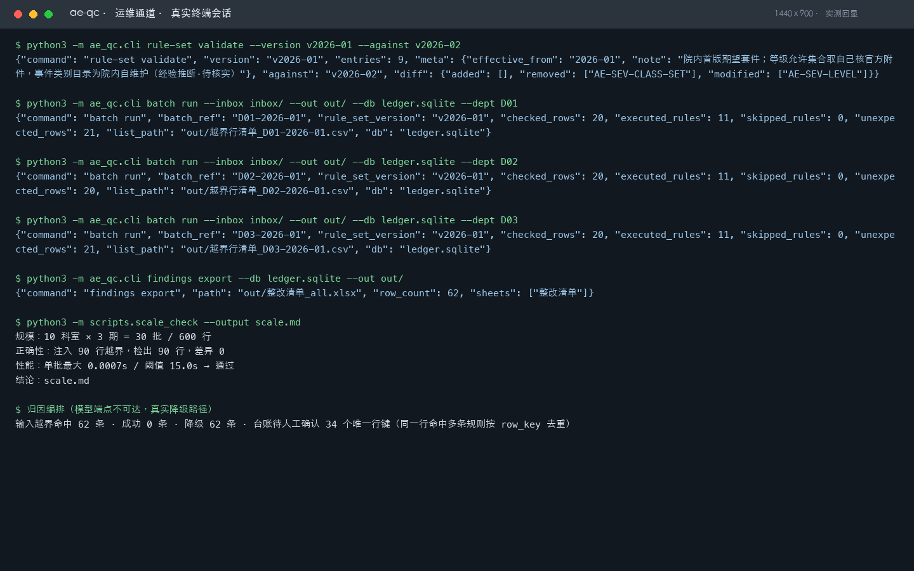
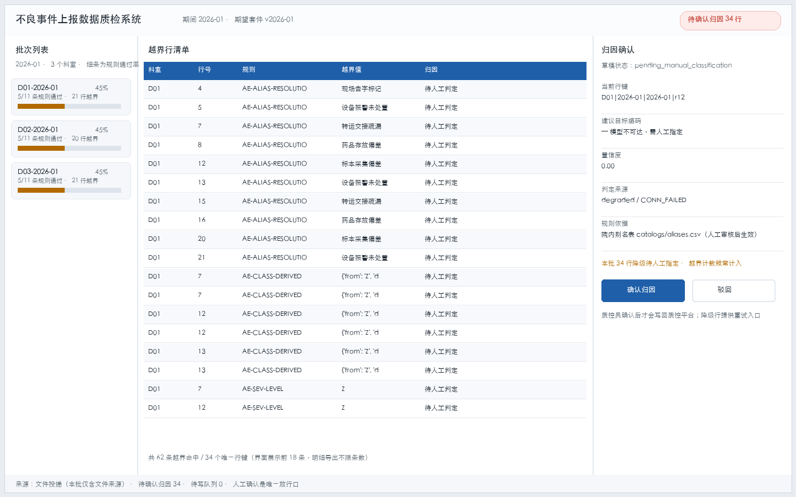
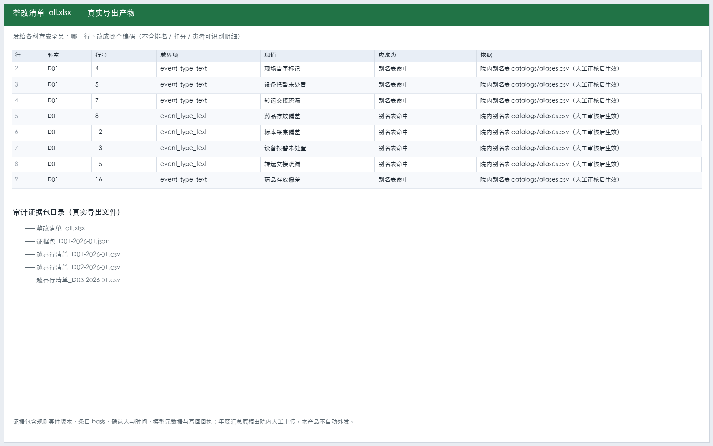

# 不良事件上报数据质检系统

> 各科室把本月的不良事件上报表丢进指定目录，质控科当场看到「哪几行的类别／等级不在分级分类口径内、每行该归到哪一类或怎么改」，人工确认后写回质控平台，并导出一份能直接发给科室的整改清单。

桌面常驻小工具（托盘 + 主窗口三栏）。质控科不再逐行翻 Excel 找「这个类别算哪一类、这个等级填对没有」，而是跑完一批就拿到逐行结论与归因草稿，确认后写回，并把「哪一行改成哪个编码」的整改清单发给科室。

## 适用场景 / 目标岗位

| 岗位 | 什么时候用 | 得到什么 |
|------|------------|----------|
| 质控科质控员 | 每月汇总前，科室上报表陆续到齐 | 本批通过率、逐行越界清单、每行待确认的归因草稿 |
| 医务科质控专员 | 汇总前复核各科室口径是否一致 | 每条校验口径的出处与所依据的规则版本，可导出证据包 |
| 各科室安全员 | 收到整改清单要改本月上报表 | 「哪一行、现值、改成什么、依据」的清单（不排名、不扣分） |
| 信息科排障岗 | 平台接口报错、某批没跑全 | 哪条规则被跳过、哪批没写回、退避几次后转入待写队列 |

## 能力要点

- **逐行指出越界**：跑完一批就把「类别／等级不在分级分类口径内」的行逐条列出来，标明现值、应改为什么、依据哪条口径。
- **把随手写的自由文本归并到目录**：上报人写「患者跌倒致骨折」「跌倒」，系统给出应归到哪一类的建议；实在归不了就说明缺哪条信息，不硬塞最近的一类。
- **每条口径都带出处**：规则条目与每条越界结论都跟着依据（依据哪份标准、哪一段），结果绑定规则版本，换人接手靠台账而不是靠个人 Excel。
- **人工确认是唯一放行口**：模型产出的归因只是草稿，不点确认就绝不写回质控平台，未确认时出站请求数恒为 0。
- **给科室的是可带走的整改清单**：按科室分组的 Excel，一行一个「该改成什么」，而不是把整张表退回去让人自己找。
- **失败不装成功**：模型不可达时越界照常计数、归因降级为待人工分类、该批不写回，原因写进审计并在主窗口提示。

## 快速开始

### 依赖

- Python **3.10+**（macOS / Windows 10+）
- 无需数据库服务、无需常驻对外端口、无需管理员权限；台账是本机 SQLite 文件
- 桌面形态依赖标准库 `tkinter`；托盘图标需额外装 `pystray` + `Pillow`，缺失时自动降级为「仅窗口」模式

### 安装

```bash
cd adverse-event-qc
python3 -m venv .venv && source .venv/bin/activate    # Windows: .venv\Scripts\activate
python -m pip install -r requirements.txt
python -m pip install -e . --no-deps                  # 装成本地包，让 `python -m ae_qc.cli` 可用
```

### 配置

复制样例并逐项填写；**九项全部从环境变量读取，缺任一项启动即报错并点名变量名**，仓库内不落任何密钥。

```bash
cp .env.example .env
```

| 配置项 | 默认值 | 说明 |
|--------|--------|------|
| `AE_BASE_URL` | 空 | 院内不良事件报告平台根地址 |
| `AE_API_TOKEN` | 空 | 读取上报数据的 Bearer 令牌 |
| `QC_BASE_URL` | 空 | 质控管理平台根地址 |
| `QC_TOKEN` | 空 | 写回发现单的 Bearer 令牌 |
| `MODEL_BASE_URL` | 空 | OpenAI-compatible 推理服务端点 |
| `MODEL_API_KEY` | 空 | 模型访问令牌 |
| `MODEL_NAME` | 空 | 模型名（由院内自建推理服务决定） |
| `MODEL_TIMEOUT` | `30` | 单次模型调用超时秒数 |
| `AE_RULE_SET` | 空 | 本批使用的期望套件版本；留空＝当前生效版本 |

不敏感的运行参数（监听间隔、样本展示上限、退避次数、保留周期等）写在 `config.toml`，见该文件注释。

### 构建与验证

```bash
# 单元测试与契约测试（引擎层不依赖图形环境，无显示环境也能全量跑）
python -m pytest tests -q

# 生成脱敏样例批次 → 跑最小切片 → 校验产物存在且非空（可重复执行，不依赖网络）
bash scripts/verify_release.sh
```

### 主命令速查

```bash
python -m ae_qc.cli doctor                 # 体检：配置、目录资产、台账、模型端点连通性
python -m ae_qc.cli rule-set validate --version v2026-01 --against v2026-02
python -m ae_qc.cli batch run --period 2026-01 --dept D01
python -m ae_qc.cli findings export --batch-ref D01-2026-01
python -m ae_qc.cli replay --batch-ref D01-2026-01 --version v2026-01
python -m ae_qc.desktop                    # 日常入口：三栏主窗口 + 托盘常驻（缺 pystray 降级为仅窗口）
```

以上命令均可在项目根目录直接执行（`python -m pytest tests -q` 依赖 `pyproject.toml` 的 `pythonpath = ["src"]`；从任意目录调用 CLI 时先 `pip install -e . --no-deps`）。`ae-qc` 是同一 CLI 的控制台脚本别名。

## 命令 / API / 配置说明

### 关键配置项

| 配置项 | 默认值 | 说明 |
|--------|--------|------|
| `AE_BASE_URL` | 空 | 上报平台根地址；入站只读来源 |
| `AE_API_TOKEN` | 空 | 上报平台读取令牌（`Authorization: Bearer`） |
| `QC_BASE_URL` | 空 | 质控平台根地址；出站写回目标 |
| `QC_TOKEN` | 空 | 质控平台写回令牌（`Authorization: Bearer`） |
| `MODEL_BASE_URL` | 空 | OpenAI-compatible 端点；模型只做语义归并与归因 |
| `MODEL_API_KEY` | 空 | 模型令牌 |
| `MODEL_NAME` | 空 | 模型名 |
| `MODEL_TIMEOUT` | `30` | 模型调用超时（秒） |
| `AE_RULE_SET` | 空 | 期望套件版本；每批结果绑定当时版本 |
| `config.toml → [engine] sample_display_limit` | `20` | 越界样本展示条数上限；全量明细仍落盘可回查 |
| `config.toml → [engine] allowed_unexpected_ratio` | `0.0` | 允许的未匹配比例阈值（低于阈值判通过但仍记数） |
| `config.toml → [attribution] max_retries` | `2` | 模型调用退避重试次数（网络级与 5xx 可重试） |
| `config.toml → [writeback] max_retries` | `3` | 写回退避重试次数；超过转待写队列 |
| `config.toml → [ledger] detail_retention_days` | `365` | 行级明细保留天数；审计与批次汇总长期保留 |

### CLI 子命令 / 接口端点

| 命令或路径 | 用途 | 关键参数 |
|------------|------|----------|
| `ae_qc.cli doctor` | 检查环境变量、目录资产、套件可加载、台账可写、模型端点可达 | 无附加参数；逐项分档输出文本 |
| `ae_qc.cli rule-set validate` | 校验期望套件条目并输出与对照版本的条目级 diff | `--version <version>`、`--against <version>`（默认最新 / 前一版本） |
| `ae_qc.cli batch run` | 跑一批：切批 → 执行期望 → 出全量越界行清单并落台账 | `--inbox`、`--out`、`--db`、`--dept`、`--period`、`--version`、`--rows` |
| `ae_qc.cli findings export` | 从台账导出整改清单 Excel（科室可带走） | `--db`、`--out`、`--batch-ref`（默认全部批次） |
| `ae_qc.cli replay` | 用指定套件版本重放投递目录里的历史批次 | `--inbox`、`--batch-ref`、`--version`、`--rows` |
| `GET {AE_BASE_URL}/api/v1/incident-reports` | 读院内上报平台的上报表（入站，只读） | `period`、`dept_code`；头 `Authorization: Bearer $AE_API_TOKEN` |
| `POST {QC_BASE_URL}/api/v1/quality-findings` | 写回已确认的发现单（出站，真实写入） | 头 `Authorization: Bearer $QC_TOKEN` + `Idempotency-Key: sha256(batch_ref\|rule_id\|row_key)` |

退出码统一：`0` 成功 / `2` 参数错 / `3` 配置缺失 / `4` 依赖端点不可达 —— 供无人值守跑批判定。

### 错误与降级

| 场景 | 表现 | 处理方式 |
|------|------|----------|
| 缺环境变量 | 启动即报错，逐个点名变量名与用途 | 不静默降级；补齐 `.env` 后重试 |
| 上报平台不可达 | 该批回落为「仅文件来源」 | 批次摘要显式标注「本批仅含文件来源」，不冒充全量 |
| 表头有未映射列 | 列进「待确认」清单交人工 | 不猜；相关规则标「未执行」而非静默通过 |
| 同一表头映射到多列 | 该列挂起并列候选 | 需人工指定；不任选其一 |
| 单条规则执行异常 | 该条记「未执行」并点名原因 | 其余规则照跑；未执行条目不计入通过率分母 |
| 模型超时／不可达／返回不合规 | 该行归因置「待人工分类」并记降级原因 | 越界照常计数、照常进清单；该批不写回 |
| 写回 4xx | 视为业务拒绝 | 不重试，落冲突记录 |
| 写回 5xx／网络错误 | 退避重试 | 超过上限转待写队列，主窗口红条提示条数 |
| 科室主数据未命中／映射到多码 | 该批次挂起 | 记原因并列候选，不猜 |

### 对接现有系统

**入站 A（院内上报平台 · HTTP 只读）**
`GET {AE_BASE_URL}/api/v1/incident-reports?period={yyyy-mm}&dept_code={dept_code}`，
请求头 `Authorization: Bearer {AE_API_TOKEN}`。响应字段与下表一致；缺列、多列、类型不符返回结构化错误码，不静默补空。

**入站 B（科室投递目录 · 本机文件）**
`inbox/<dept_code>/<period>.xlsx`。**列名从表头读**，映射表可编辑；未映射列进待确认清单。必填列缺失时整表判为不可用批次，不产出半截结果。

| 标准列 | 类型 | 口径要求 |
|--------|------|----------|
| `incident_id` | string | 院内事件号；跨表不保证唯一 → 行键另算内容指纹 |
| `dept_code` | string | 科室编码，须命中院内科室主数据 |
| `event_type_text` | string | 上报人填的自由文本事件名 |
| `event_type_code` | string \| null | 分类目录编码，可空 |
| `severity_level` | string \| null | 等级 A–I |
| `severity_class` | string \| null | 类别 Ⅰ–Ⅳ，派生列，须与等级一致 |
| `occur_time` | ISO8601 | 发生时间，须 ≤ `report_time` |
| `report_time` | ISO8601 | 上报时间 |
| `reporter_role` | string | 上报人角色；不落姓名／住院号／诊断明细 |
| `harm_desc` / `root_cause_text` | string \| null | 后果描述、初步原因（自由文本） |

**出站（质控管理平台 · 真实写入）**
`POST {QC_BASE_URL}/api/v1/quality-findings`，请求头 `Authorization: Bearer {QC_TOKEN}`、
`Idempotency-Key: sha256(batch_ref|rule_id|row_key)`。body 字段：
`finding_id` / `batch_ref` / `dept_code` / `period` / `rule_id` / `rule_set_version` /
`observed_value` / `unexpected_count` / `unexpected_samples[]` / `attribution_draft` /
`attribution_confidence` / `status` / `confirmed_by` / `confirmed_at`。

只有状态为「已确认」的发现单才允许出站；未确认时出站请求数 = 0。幂等键保证同一键重发只产生一条发现单。

**测试替身边界**：协议替身只出现在测试层（用于断言我们发出去的 body 逐字段符合上面的正式接口规范），不构成最终对接方式；院内按上述规范实现即可直接对接。

## 典型场景

### 场景 1：质控科质控员 · 月底汇总前跑批

1. 科室把本月上报表丢进 `inbox/<科室编码>/2026-01.xlsx`；
2. 点「开始跑批」，等进度条走完，右上角出现本批通过率与越界行数；
3. 中栏逐行看越界值，右栏逐行确认或驳回归因草稿。

```bash
python -m ae_qc.cli batch run --period 2026-01 --dept D01
# 产出 out/越界行清单_D01-2026-01.csv，九列：批次号 / 科室编码 / 期间 / 行号 / 规则 / 越界列 / 现值 / 应改为 / 依据
```

### 场景 2：各科室安全员 · 拿到整改清单改表

1. 质控员导出整改清单（按科室分 sheet），发给对应科室安全员；
2. 科室按「行号 + 应改为」逐行改自己的表，不用自己猜分类；
3. 改完重新投递，下一批自动比对是否已改到位。

```bash
python -m ae_qc.cli findings export --batch-ref D01-2026-01
# 产出 out/整改清单_D01-2026-01.xlsx，列：科室 / 行号 / 越界项 / 现值 / 应改为 / 依据
```

### 场景 3：信息科排障岗 · 某批没跑全 / 平台拉不到数据

1. 先跑体检，看是配置缺项、目录资产缺失还是端点不可达；
2. 看引擎运行摘要：哪条规则被跳过、跳过原因、这批越界了多少行；
3. 端点恢复后重跑该批（幂等，不重复计数、不重复写回）。

```bash
python -m ae_qc.cli doctor
python -m ae_qc.cli replay --batch-ref D01-2026-01 --version v2026-01
```

## 输出样例

### 批内越界行清单

下面是 `python -m ae_qc.cli batch run --period 2026-01 --dept D01` 在脱敏合成样例上真实产出的 `out/越界行清单_D01-2026-01.csv` 片段（不含院内真实数据）：

```csv
批次号,科室编码,期间,行号,规则,越界列,现值,应改为,依据
D01-2026-01,D01,2026-01,7,AE-SEV-LEVEL,severity_level,Z,"[""A"", ""B"", ""C"", ""D"", ""E"", ""F"", ""G"", ""H"", ""I""]",《医疗质量安全不良事件分级分类标准》附件2（已核原文）
D01-2026-01,D01,2026-01,12,AE-SEV-LEVEL,severity_level,Z,"[""A"", ""B"", ""C"", ""D"", ""E"", ""F"", ""G"", ""H"", ""I""]",《医疗质量安全不良事件分级分类标准》附件2（已核原文）
```

完整命令与 stdout 回显见 `docs/examples.md`（由截图采集脚本自动写下，可重复执行核对）。

### 整改清单

`findings export` 从同一台账导出 Excel，真实片段如下。行数与全量越界行数一致（展示截断不影响台账条数），不含姓名、住院号、诊断明细，也不含上报量排名、扣分、绩效联动类字段。

| 科室 | 行号 | 越界项 | 现值 | 应改为 | 依据 |
|------|------|--------|------|--------|------|
| D01 | 4 | event_type_text | 现场𠮷字标记 | 别名表命中 | 院内别名表 catalogs/aliases.csv（人工审核后生效） |
| D01 | 5 | event_type_text | 设备报警未处置 | 别名表命中 | 院内别名表 catalogs/aliases.csv（人工审核后生效） |
| D01 | 7 | event_type_text | 转运交接疏漏 | 别名表命中 | 院内别名表 catalogs/aliases.csv（人工审核后生效） |

### 审计证据包

按批次导出的 JSON 证据包（真实文件名 `证据包_D01-2026-01.json`）包含：规则套件版本与每条口径出处快照、期望结果摘要、行级证据计数、模型调用元数据、确认人与确认时间、写回回执。用途是回答「这批数是用哪套口径查的、谁确认的、写回成功没有」。年度汇总底稿只出本地文件，由院内人工上传，本产品不自动外发。

## 概念 / 实测对照

### 视觉目标

视觉目标卡落在 `docs/concepts/visual-target.md`（结构化卡片，含配色、版式、信息层级与「必须可达」约束）。核心画面：左栏批次列表按期间分组、通过率以细条呈现；中栏越界行表表格优先、信息密度高；右栏归因确认面板显示草稿、置信度、建议编码与依据。色板底 `#F5F7FA` / 面板 `#FFFFFF` / 主色 `#1F5FA9` / 成功 `#2E7D4F` / 警告 `#B26A00` / 错误 `#C0392B`；8px 间距栅格；中文系统字体栈；表格行高 32px。全部效果只依赖 `tkinter` 原生控件、样式与 `Canvas`，不画现有依赖做不到的东西。

### 实测证据

三张实测图由 `python3 scripts/capture_screenshots.py` 可重复生成，数据来自真实 CLI 跑批、真实 SQLite 台账、真实归因降级链路与真实导出文件（脱敏合成样例，未实连院内系统）：

| 文件 | 记录的是什么 |
|------|--------------|
| `docs/screenshots/01-cli-batch-run.png` | 真实终端会话：`rule-set validate`、三个科室的 `batch run`、`findings export`、`scale_check` 的逐行 stdout，以及模型端点不可达时的真实降级回显 |
| `docs/screenshots/02-main-window.png` | 真实主窗口三栏：左栏批次列表与 `batch_stats` 算出的规则通过率细条、中栏台账里的越界行、右栏真实落库的归因草稿（降级态） |
| `docs/screenshots/03-rectify-list.png` | 真实导出的整改清单 xlsx 表头与前几行、同批审计证据包目录树 |







> **诚实标注**：上为视觉目标（`docs/concepts/visual-target.md`），下为真实运行证据，两者不声称完全一致。本自动化环境没有屏幕录制权限（`screencapture` 与 Pillow `ImageGrab` 均被系统拒绝），因此这三张不是屏幕级逐像素截屏，而是把真实 CLI stdout、真实台账数据与真实 xlsx / 证据包按窗口结构渲染出来的证据图；它们不是设计稿、示意图或概念图，也不冒充逐像素界面截图。配色、三栏宽度与 8px 栅格按目标实现，真实 tkinter 窗口的字距、控件边框仍受操作系统主题影响；右栏展示的是模型端点不可达时的真实降级态 `pending_manual_classification`，不是模型给出建议编码的成功态。完整未截断回显见 `docs/examples.md`。

## 架构与数据流

```
   科室投递目录                    院内上报平台
  inbox/<dept>/<period>.xlsx     GET /api/v1/incident-reports
            │                              │
            └────────────┬─────────────────┘
                         ▼
              ┌──────────────────────┐
              │  ingest/  读入与切批   │  表头驱动取列 · 脏行计数 · 科室×期间两级切批
              └──────────┬───────────┘  未映射列不猜 → 待确认清单
                         ▼
              ┌──────────────────────┐
              │  engine/  期望套件引擎 │  规则 × 列 执行计划 · 单规则失败隔离
              │  （口径资产可版本化）  │  行级证据 · 内容指纹 · 幂等行键
              └──────────┬───────────┘
                         ▼
              ┌──────────────────────┐
              │ attribution/ 归因    │  别名表优先 · 模型归并与归因草稿
              │  ModelGateway 单入口  │  模型不可达 → 待人工分类（不写回）
              └──────────┬───────────┘
                         ▼
              ┌──────────────────────┐
              │  ledger/  台账·状态机  │  SQLite · 幂等键 · 审计流水
              │  collected→…→archived  │  人工确认是唯一推进口
              └──────────┬───────────┘
                         ▼
        ┌────────────────┴────────────────┐
        ▼                                 ▼
┌────────────────┐              ┌────────────────────┐
│ writeback/ 写回 │              │ reporting/ 导出     │
│ POST 发现单     │              │ 整改清单 · 年度底稿 │
│ (幂等键 · 退避) │              │ 审计证据包          │
└────────────────┘              └────────────────────┘
```

### 关键不变量

- **幂等键**：`sha256(batch_ref|rule_id|row_key)`；同一键重复投递不增行、同键重发只发一次。
- **状态校验**：只有「已确认」允许出站；模型草稿永不推进状态；非法状态迁移被拒并记审计。
- **失败不静默改数据**：模型不可达 → 该行降级为待人工分类、该批不写回；缺列只提示不阻断、不猜值。
- **口径可复现**：每批结果绑定当时的规则套件版本与条目出处快照，旧版本重跑结论一致。
- **展示与台账一致**：界面上「共 N 条越界」等于台账全量明细条数，截断只影响展示。

## 安全与合规边界

- 只做上报数据的**口径校验与归因草稿**，不产出诊断、治疗建议，也不代签任何结论。
- 不采集、不落库患者可识别明细（姓名、住院号、诊断明细）；只留科室、角色、时间与口径相关的字段。
- 按上级关于不良事件信息管理的要求，产品**不产出上报量排名、扣分、绩效联动类字段**（导出表头与出站 body 均以断言锁死），年度汇总表只出底稿、由院内人工上传，不自动外发。
- 模型的产出永远是草稿：未经人工确认不写回、不改变业务状态、不判定「已整改」。

## 验收与自检

| 验收项 | 命令 | 期望结果 |
|--------|------|----------|
| 安装依赖 | `python -m pip install -r requirements.txt` | 无报错，`pydantic` / `openpyxl` / `httpx` 均可导入 |
| 体检 | `python -m ae_qc.cli doctor` | 逐项分档输出：可用 / 缺配置 / 资产缺失 / 端点不可达 |
| 缺配置即报错 | 去掉 `QC_TOKEN` 后跑 `batch run` | 退出码 3，并点名 `QC_TOKEN` 及用途 |
| 规则套件可加载 | `python -m ae_qc.cli rule-set validate --version v2026-01 --against v2026-02` | 输出条目数、meta 与 `added/removed/modified` 三段 diff |
| 跑批出清单 | `python -m ae_qc.cli batch run --period 2026-01 --dept D01` | 生成 `out/越界行清单_D01-2026-01.csv`，行数与 stdout 的 `unexpected_rows` 一致 |
| 导出整改清单 | `python -m ae_qc.cli findings export --batch-ref D01-2026-01` | 生成 `out/整改清单_D01-2026-01.xlsx`，`row_count` == 全量越界行数 |
| 历史批次可复现 | `python -m ae_qc.cli replay --batch-ref D01-2026-01 --version v2026-01` | 用绑定版本重放，逐条结论一致 |
| 幂等 | 同一批连跑两次 | 台账不增行、越界计数不翻倍、出站请求不重复 |
| 未确认不写回 | 确认前跑写回 | 出站请求数 = 0 |
| 引擎层无图形依赖 | `python -m pytest tests -q` | 无显示环境下全量通过 |
| 对照评测 | `python -m scripts.eval_merge` | 200 条标注集出对照表；模型不可用时只出基线并显式标注 |
| 规模验收 | `python -m scripts.scale_check` | 10 科室 × 3 期 / 600 行，越界差异 0、单批耗时 ≤ 15s |
| 实测证据 | `python -m scripts.capture_screenshots` | 生成三张 PNG 与 `docs/examples.md`，数据均为真实运行 |
| 发布前自检 | `bash scripts/verify_release.sh` | 退出码 0，产物存在且非空 |

评测与规模验收的实测数字分别落在 `docs/语义归并对照表.md` 与 `docs/规模验收结论.md`；阈值写在 `config.toml` 的 `[scale] max_batch_seconds`。

## 项目结构

```
adverse-event-qc/
├── src/ae_qc/
│   ├── config.py                 # 环境变量 + config.toml 加载；缺项即报错并点名变量名
│   ├── models.py                 # pydantic 数据契约：规则条目 / 期望结果 / 行级证据 / 归因草稿 / 发现单
│   ├── errors.py                 # 分层错误码表与处置建议；doctor 与降级路径共用
│   ├── logging_util.py           # 结构化 JSON 日志与每批运行摘要
│   ├── cli.py                    # 运维通道：doctor / rule-set validate / batch run / findings export / replay
│   ├── doctor.py                 # 体检：配置、目录资产、台账可写、端点分级
│   ├── ingest/                   # 入站：xlsx_reader 表头驱动取列与脏行计数、column_mapping 未映射列不猜、
│   │                             # ae_platform_client 上报平台只读、batch_splitter 科室×期间切批、batch_summary 来源标注
│   ├── engine/                   # ★ 核心模块一：ruleset 条目 schema 与版本 diff、rule_kinds 七种规则族、
│   │                             # executor 批量计划与单规则失败隔离、result 统一结果结构、
│   │                             # row_locator 行级证据、detail_store 全量明细落盘、fingerprint 内容指纹、
│   │                             # cross_batch_duplicate 跨批重复、severity_matrix 一致性矩阵与仲裁、
│   │                             # aggregate 通过率聚合、resume 断点续跑、engine_logging 结构化日志
│   ├── attribution/              # ★ 核心模块二：model_gateway 单一模型网关、merge 自由文本归并与目录复核、
│   │                             # explain 归因草稿、degradation 降级、orchestrator 批量编排、
│   │                             # feedback_loop 人工确认/驳回回流别名候选、policy_extract 制度原文抽取
│   ├── ledger/                   # 台账：store SQLite 版本化迁移与 WAL、state_machine 状态迁移与非法迁移拒绝、
│   │                             # idempotency 幂等键、audit 审计流水、queries 只读查询层
│   ├── writeback/                # qc_client 质控平台写回、guard 前置校验、contract 字段白名单、queue 待写队列
│   ├── reporting/                # rectify_list 整改清单、annual_draft 年度底稿（院内人工上传）、
│   │                             # evidence_pack 审计证据包、headers 字段白名单与脱敏检查器
│   └── desktop/                  # theme 设计 token、app 主窗口三栏装配、views 批次列表/越界表/确认面板、
│                                 # data_source 界面唯一取数入口、tray 托盘常驻、watcher 目录监听与轮询、
│                                 # states 三态文案、__main__.py 桌面启动入口（唯一建 Tk 的地方）
├── scripts/                      # demo_minimal.sh / e2e_check.sh / verify_release.sh 发布自检；
│                                 # eval_merge.py 对照评测、scale_check.py 规模验收、
│                                 # capture_screenshots.py 实测证据采集、fetch_reference_docs.py 公开口径抓取、
│                                 # gen_sample_batches.py 脱敏样例生成、demo_minimal.py / e2e_run.py 最小切片
├── tests/                        # pytest：58 个测试文件，引擎层零 GUI 依赖，无显示环境可全量跑
├── catalogs/                     # 目录资产（院内自维护，每条带出处）：severity_levels 等级 A–I、
│                                 # event_categories 事件类别目录、aliases 别名表、dept_master 科室主数据、
│                                 # column_mapping 列映射、severity_matrix 一致性矩阵；rulesets/ 两版期望套件
├── assets/                       # reference/ 公开口径断网内置副本、case_set/cases.json 案例集、
│                                 # eval/labeled_event_names.json 200 条评测标注集
├── docs/                         # concepts/visual-target.md 视觉目标卡；screenshots/ 三张实测证据图；
│                                 # examples.md 完整回显；语义归并对照表.md；规模验收结论.md
├── inbox/                        # 科室投递目录（运行时输入，空目录时样例生成器兜底）
├── out/                          # 运行时导出产物（.gitignore 排除，不进发布仓库）
├── requirements.txt              # 运行依赖；.env.example 九项环境变量样例（凭据只从环境变量读）
├── pyproject.toml                # src 布局 + pytest pythonpath=src + ae-qc 控制台脚本
├── config.toml                   # 非敏感运行参数（含 [scale] 单批耗时阈值）
├── .gitignore                    # 排除密钥、虚拟环境、缓存、运行时数据与 round 元数据
├── qrcode.jpg                    # 关注我们二维码
└── README.md
```

## License

MIT

---

## 关注我们

欢迎扫码关注公众号，获取项目更新与交流加群：

